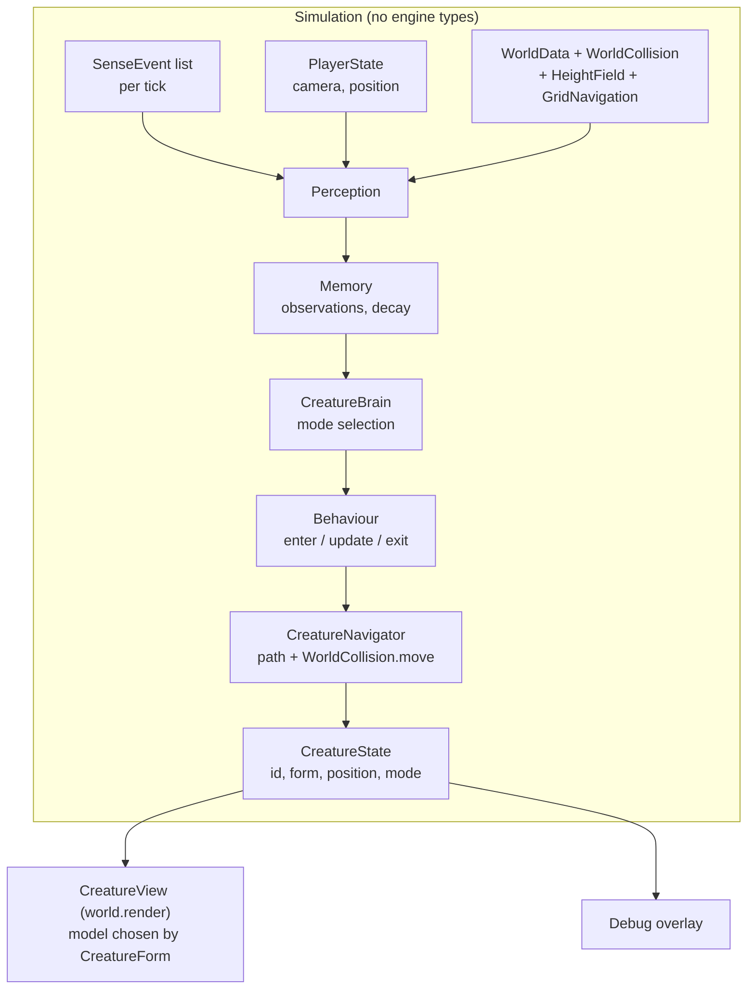
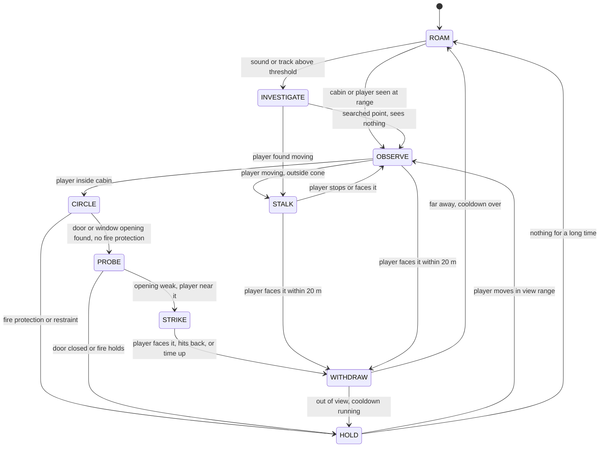
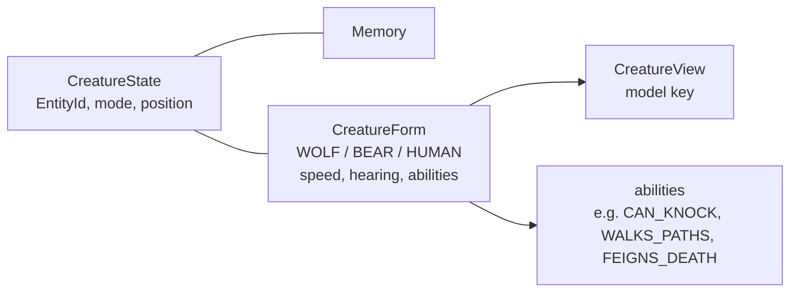

# Creature AI Design

Status: **Proposed.** Nothing in this document is implemented. The `creature` package is empty (`creature/package-info.java`). Facts about the existing world that the design relies on are marked with their source file.

See also: [SURVIVAL_GAMEPLAY_ROADMAP.md](SURVIVAL_GAMEPLAY_ROADMAP.md) (phases), [SURVIVAL_SYSTEM_DESIGN.md](SURVIVAL_SYSTEM_DESIGN.md) (fire, clock, cues), [AI_TESTING_STRATEGY.md](AI_TESTING_STRATEGY.md) (tests).

## 1. Design intent

The creature is a predator that studies the player. It is not a chaser. It acts on imperfect information, prefers to stay unseen, uses cover, and often chooses to wait. Its restraint is part of the fear. Behaviour should look intelligent, but the implementation stays small enough to test without rendering.

Three rules shape everything below:

1. **Information barrier.** The creature decides from its memory. Memory is filled only by perception. Perception is limited by range, light, cover and hearing. The creature never reads the player's position directly.
2. **Camera and geometry together.** "The player can see me" is the player's view cone (camera yaw and pitch) **and** line of sight through the world. Neither alone is enough.
3. **Identity is not appearance.** The creature is one entity with one memory. A form (wolf, bear, human) changes what it looks like and what it can do, not who it is.

## 2. Architecture

### 2.1 Layers



| Layer | Package | Engine types | Holds |
|---|---|---|---|
| Identity and state | `creature` | none | `CreatureState` (EntityId, form, x, z, heading, mode) |
| Perception | `creature` | none | `Perception` (reads the world, returns observations) |
| Memory | `creature` | none | `Memory`, `Observation` |
| Decision | `creature` | none | `CreatureBrain`, `CreatureMode`, `Considerations` |
| Behaviour | `creature.behaviour` | none | one class per behaviour |
| Navigation | `creature` + `world.query` | none | `CreatureNavigator`, `GridPathFinder` |
| Presentation | `world.render` | yes | `CreatureView`, debug view |

The creature packages must not import `com.jme3`. A test enforces this with a source scan (see the testing strategy).

### 2.2 Where the creature runs

`WorldSimulation` owns a `CreatureSimulation` (one creature in Phase B, a list later). It calls it once per fixed step (20 Hz). Perception and brain run on a slower schedule, while navigation runs every step:

| Work | Rate | Why |
|---|---|---|
| Movement (navigator steps the creature) | 20 Hz | Smooth, collision-correct |
| Perception (vision and hearing) | 5 Hz (every 4th step, 0.2 s) | Line-of-sight is the expensive part |
| Brain (mode choice) | 1 Hz (every 20th step) | Decisions are slow on purpose |
| Path replanning | every 2 s, or when blocked | Bounded A* cost |

Per-tick inputs are a read-only snapshot: `PlayerState` for each player, the world, the hearth and chimney state (read-models), and this tick's `SenseEvent` list. Output is a new `CreatureState` value, mutated in place by the simulation only.

### 2.3 Sense events

`SenseEvent(kind, x, z, loudness, time)`, a record. It is produced by the simulation when something happens: a footstep, a door opening, an item dropped or placed, a tree felled, a chimney scrape, a knock. The list is cleared at the end of each tick. This is not an event bus: there are no subscribers, the creature reads the list it is given.

| Kind | Loudness (m, hearing radius before walls) | Source |
|---|---|---|
| FOOTSTEP_WALK | 6 | `StepCount` stride, walking |
| FOOTSTEP_SPRINT | 14 | `StepCount` stride, sprinting |
| DOOR | 20 | Cabin door opened or closed |
| DROP | 4 | Item dropped |
| PLACE | 3 | Item placed |
| CHOP | 30 | Tree felled (Phase A overlay) |
| KNOCK | 16 | Creature's own door probe (creature's own events are not heard by itself) |
| SCRAPE | 8 | Chimney block by creature |
| SPEECH | 18 | Human form (Phase E) |

Loudness values are proposals. Tune them in playtest with the cue log.

### 2.4 Why this architecture

Options considered:

| Option | Verdict |
|---|---|
| **Pure finite state machine** | Too many transitions once cover, stalking, circling and restraint all interact. Each new behaviour multiplies the transition table. |
| **Behaviour tree** | Good for many authored actions. It adds a framework and a tree editor concept that the project does not need for nine modes. Rejected for now. |
| **GOAP** | Planning over world states is heavy, and it would be hard to explain or tune by hand. Rejected. |
| **Utility AI only** | Scores every behaviour every tick. Works, but the creature then has no stable intent (it flickers) and restraint is hard to express. |
| **Chosen: mode finite state machine with scored mode choice and committed behaviours** | Small number of named modes that are easy to log and test. Scores decide which mode, with hysteresis. Each mode is a small class. |

The chosen design is a two-level structure. The top level is a small enum of nine modes. Transitions are not hand-written pairs: at each brain tick, every mode's score is computed from considerations, and the best mode wins unless it is within the hysteresis band of the current mode or the current mode's minimum commit time has not passed.

## 3. Perception

### 3.1 Vision

Inputs: creature position `(cx, cz)`, creature eye height (1.6 m), player position and eye height (`PlayerState.y` + 1.65 m, matching `WorldSimulation.AIM_EYE_HEIGHT`), player yaw and pitch (`PlayerState.yaw`, `pitch`).

| Test | Rule (proposed value) |
|---|---|
| Range | 60 m by day, 35 m at dusk, 15 m at night. Read from `WorldClock.phase()`. A lit cabin window adds a light bonus within 10 m only for the cabin. |
| Creature's own field of view | 120° horizontal cone, 60° vertical. Peripheral sight is poor; the creature notices movement outside the cone only inside 8 m. |
| Line of sight, 2D | `WorldCollision.lineClear` with the creature's radius (0.4 m). Trees, rocks and buildings block. Existing function, used by placement only today. |
| Line of sight, 3D terrain | Sample the ray every 2 m: if `HeightField.heightAt(sample)` is above the ray height at that sample by more than 0.2 m, it is blocked. Ridges and hollows occlude. |
| Player's view of the creature | Angle between the player's look vector (from yaw and pitch) and the creature direction is within 35° horizontal and 25° vertical, **and** the same line of sight holds. This is what the creature uses to decide whether it is "watched". |

Output: `Observation(kind=SIGHT, x, z, time, confidence = 1.0, watchedByPlayer = boolean)`. The creature records the player's last seen position and facing. Facing is only recorded inside 25 m, which is the creature's read of "the player is looking this way", and only through clear line of sight.

**Visibility is symmetric by construction.** The same line-of-sight function serves both directions. Visibility by the player's camera is shown to the player as the creature's model. This keeps both sides consistent.

### 3.2 Hearing

A sense event is heard if the distance from the event to the creature is within `loudness`. Walls attenuate: the effective loudness is multiplied by 0.35 for each solid footprint the line crosses (cabin or building), using `WorldCollision.lineClear`'s blocking result. Wind masks sound in Phase F (not in this milestone).

Hearing gives an observation of kind `SOUND` at the event's position, with confidence = `clamp(1 - distance / loudness, 0.3, 0.9)`. A sound never gives exact information: confidence is capped at 0.9, and the position is jittered by a seeded offset of up to 1.5 m.

### 3.3 Environmental awareness

| Signal | Source | Observation | Lifetime (game minutes, proposed) |
|---|---|---|---|
| Footprints in snow | Player's `StepCount` strides recorded as breadcrumbs, one per 6 m, in a ring buffer of 40 | `TRACK` at the breadcrumb, confidence 0.6 | 90 (snow covers them; Phase F may vary) |
| Disturbed objects | Item drop, place, pickup, felled tree | `CHANGED` at the spot, confidence 0.5 | 240 |
| Fire and light | Hearth state (BURNING) and cabin windows | `LIGHT` at the cabin, confidence 0.8 at night, 0.2 by day | while the state holds |
| Smoke | Hearth level and chimney | `SMOKE` at the cabin, confidence proportional to level | while the state holds |
| Recently occupied places | Player occupancy on a 16 m grid, counted per clock phase | Used as **routine** prior, not as an observation | 1 game day, decays |

Track and change observations are the main way the creature "learns" the player's route. The routine prior is weaker: it chooses where to HOLD or CIRCLE (cells the player often passes), it never says where the player is now.

### 3.4 Perception budget

- Vision: at most 2 line-of-sight checks per tick for the single creature in Phase B (player's sight of creature and creature's sight of player). Each check is at most 50 samples.
- Hearing: at most 8 events processed per perception step; extra events are dropped oldest first and the drop is counted in the debug overlay.
- No allocation in the inner loops: preallocated `Observation` buffer of 16 entries, reused.

## 4. Memory

### 4.1 Structure

```
Memory
  observations: Observation[32]   // bounded, preallocated, reused
  lastPlayer:   per PlayerId -> (x, z, time, confidence, watchedByPlayer)
  suspicion:    0..1  // how much the creature believes the cabin holds the player
```

`Observation(kind, x, z, time, confidence, source)`. Kinds: SIGHT, SOUND, TRACK, CHANGED, LIGHT, SMOKE, KNOCK.

### 4.2 Update rules

1. **Merge.** A new observation within 8 m of an existing one of the same kind replaces it if its confidence is at least as high; otherwise it refreshes the existing entry's time only.
2. **Capacity.** At 32 entries, the lowest current confidence is evicted. Ties evict the oldest.
3. **Decay.** Confidence decays linearly with age: `c(t) = c0 * max(0, 1 - age / lifetime(kind))`. Linear, not exponential, so tests can compute exact values and no floating point drift accumulates. Lifetimes (game minutes, proposed): SIGHT 4, SOUND 3, TRACK 90, CHANGED 240, LIGHT and SMOKE while the state holds, KNOCK 6.
4. **Expiry.** Observations with `c(t) = 0` are removed at the next brain tick.
5. **Suspicion.** Rises by 0.2 per KNOCK, 0.05 per LIGHT-at-night tick, 0.1 per SOUND from the cabin; decays by 0.02 per game minute with no cabin-related observation. Clamped to [0, 1].

### 4.3 What memory answers

| Question | Answer from | Confidence use |
|---|---|---|
| Where did I last see the player? | `lastPlayer` (SIGHT only) | Used directly for INVESTIGATE; confidence < 0.2 means "last known, stale" |
| Where did I last hear something? | SOUND observations, newest with highest confidence | INVESTIGATE target |
| Is the player likely in the cabin? | `suspicion` with LIGHT, SMOKE, KNOCK, DOOR evidence | Chooses PROBE and HOLD near the cabin |
| Where does the player walk? | TRACK and routine prior | Chooses cover for OBSERVE and STALK |
| What changed here? | CHANGED | INVESTIGATE target, short-lived |

The creature must **lose confidence in outdated information**. A sighting from 5 game minutes ago is at confidence 0 and cannot drive INVESTIGATE. Without fresh information the creature searches around the last known point, then falls back to HOLD or ROAM.

## 5. Behaviour

### 5.1 Modes



| Mode | Purpose | Commit time | Ends when |
|---|---|---|---|
| ROAM | Wander between seeded waypoints in forest cover | 10 s | a stronger candidate wins |
| INVESTIGATE | Go to the best SOUND, TRACK or CHANGED observation and search around it | 15 s | search done or evidence is stale |
| OBSERVE | Stand in cover with line of sight to the cabin or trail, outside the player's cone | 8 s | the player moves into a stalk, faces it, or leaves |
| STALK | Follow at 25–40 m through cells outside the cone | 4 s, re-scored | the player stops, faces it, or is out of range |
| CIRCLE | Walk a ring 12–18 m around the cabin, cover cells only | 10 s | a door or window opening is found, or restraint |
| PROBE | At an opening, make a knock or scrape (a sense event) and wait | 6 s | the player responds, or time |
| HOLD | Stand still in cover, quiet; waiting for opportunity | 10 s | any observation |
| STRIKE | Commit to an attack on the opening when the player is near it | 20 s | resolved (Phase D) or aborted |
| WITHDRAW | Leave by cover, out of view, to a point at least 40 m away | 5 s | out of view and at distance; cooldown starts |

### 5.2 Considerations

Each mode's score is the product of considerations in [0, 1], multiplied by a mode weight. A consideration is a pure function of memory, world and phase. Initial set:

| Consideration | Used by | Definition (proposed) |
|---|---|---|
| `playerWatchingMe` | WITHDRAW (up), STRIKE (down) | 1 if `watchedByPlayer` in the last 2 s, else 0 |
| `playerDistance` | STALK, WITHDRAW, OBSERVE | Distance mapped to a 25–40 m sweet spot for STALK |
| `evidenceFresh` | INVESTIGATE, STALK | Max confidence of recent observations |
| `cabinSuspicion` | CIRCLE, PROBE, HOLD | `suspicion` from memory |
| `fireProtection` | STRIKE (down), CIRCLE (up for HOLD) | 1 if hearth BURNING at level ≥ 0.3 and within 25 m, else 0 |
| `coverAvailable` | OBSERVE, HOLD, STALK | Fraction of cells within 10 m that are outside the player's cone and out of line of sight |
| `nightness` | STRIKE, PROBE (up), ROAM (down) | 0 by day, 1 at night, from `WorldClock` |
| `restraint` | STRIKE, PROBE (down) | 0 right after near-contact, rises back to 1 over the cooldown (3–6 game minutes) |
| `hunger` (form-dependent, Phase E) | STRIKE (up) | Stays 0 until Phase E |

Mode weights are constants in `CreatureParameters.DEFAULT`. Example: `score(STRIKE) = 0.9 * nightness * (1 - playerWatchingMe) * (1 - fireProtection) * restraint * suspicion-gated opening`. **Restraint:** even when STRIKE's score is highest, a seeded roll (per brain tick, 15% chance) selects HOLD instead. The random stream is `RandomStreams` for the creature, so runs are repeatable.

### 5.3 Hysteresis and commitment

- A new mode replaces the current one only if its score exceeds the current mode's by 15%, **and** the current mode's minimum commit time has passed. STRIKE and WITHDRAW are exceptions: WITHDRAW always overrides the others when `playerWatchingMe` is 1 for 1 s.
- Scores are computed every brain tick, even when the mode is committed, so the debug overlay shows the alternatives.

### 5.4 Behaviour interface

```java
// Sketch only: not implemented.
interface Behaviour {
    void enter(CreatureContext ctx);
    BehaviourStatus update(CreatureContext ctx, float dt);  // RUNNING, SUCCEEDED, FAILED
    void exit(CreatureContext ctx);
}
```

One class per behaviour, no shared base class. `CreatureContext` is a read-only view: memory, perception output, world, hearth read-model, clock read-model and the navigator. Behaviours return a status; the brain decides what follows.

### 5.5 Behaviour details (selected)

- **OBSERVE and HOLD (cover selection).** Candidate cells: walkable cells within 6–14 m of the target (cabin or trail). A cell is valid if it is outside the player's cone and has no line of sight from the player. Score: distance to the target (closer is better, within range), cover (more solid cells around it is better), and routine (cells the player often uses score lower, so the creature stays off the route). Pick the best; ties broken by the seeded stream.
- **STALK.** Each navigator replan picks a path that prefers cells outside the cone (path cost +4 for cells inside the cone). The creature stops when the player's yaw turns toward it inside 25 m.
- **INVESTIGATE.** Target is the highest-confidence SOUND, TRACK or CHANGED observation above 0.2. The creature walks there, then searches: 3 points at 4 m offsets (seeded). Each point that yields no sight lowers the observation's confidence by half.
- **CIRCLE.** Ring waypoints every 30°, 12–18 m from the cabin centre, skipping cells in the player's cone. Circling direction is seeded and reversed on blocked paths.
- **PROBE.** Stand 2–3 m from the opening. At the start, emit KNOCK (door) or SCRAPE (chimney). Wait. If the player opens the door or responds, return to OBSERVE with suspicion updated.
- **WITHDRAW.** Path to the nearest cover cell that is out of the player's sight, then to a point at least 40 m away. Starts a restraint cooldown.
- **STRIKE (Phase D).** Only from PROBE, only when the opening is open or weak and the player is within 3 m of it. Resolution is in Phase D's design.

### 5.6 Navigation

`CreatureNavigator` holds the current path (a list of cell centres). It steers toward the next centre with `WorldCollision.move(x, z, dx, dz, radius)`, which already handles collision and slides along walls. If progress is less than 0.2 m per second for 2 s, the navigator marks the path blocked and replans.

`GridPathFinder` (new, `world/query`) is A* over the same walkable array `GridNavigation` builds. Cell size is 4 m (the terrain grid is 2 m; the navigator works coarser to keep A* cheap). Node budget: 4000 per search. If the budget runs out, the search returns the best partial path toward the goal, and the brain treats that as a failed path. The brain checks its own budget and never runs more than two searches per brain tick.

Walkability is shared with the player via `TerrainRules.walkable` (slope and water). Buildings are solid by `GridNavigation`. The cabin door is closed by default, so it is a wall for navigation until opened (see the risk note on the door in section 9).

## 6. Shapeshifting and disguise

### 6.1 Separation of identity, form and behaviour



- `CreatureState.id` never changes when the form changes.
- `Memory` is kept across forms. This is the point of the design: the creature that was a wolf remembers the player who saw it.
- `CreatureForm` is an enum whose constants hold data: speed multipliers, hearing multiplier, sight range multiplier, a set of abilities (`EnumSet`), and a model key used by the view. There is no subclass per form.
- The view maps the model key to a `PropKind`-like catalogue entry (`CreatureModel`), never to a file name in the simulation.

### 6.2 Forms

| Form | Phase | Parameters (proposed) | Behaviour |
|---|---|---|---|
| WOLF | B and C (the only form until E) | sprint 6 m/s, stalk 2.5 m/s, hearing ×1.0, sight ×1.0 | Stalks and circles. Feigned death is a HOLD variant with no movement and no sound. Attacks only when the player is within 4 m and not facing it. |
| BEAR | E | speed 4 m/s, hearing ×0.8, sight ×0.8 | Attracted to food sense events (rations left outside, garbage). Stays out of the cabin cone. Leaves when a fire is lit and the player is near. |
| HUMAN | E | walks paths (lower cost on `PathKind` routes), hearing ×1.0, sight ×1.0 | Knocks (PROBE with a KNOCK and a SPEECH event). Chooses one of a few short lines from a branch table based on the player's last action and the hearth state. |

### 6.3 Human form and deception (Phase E, design only)

- The human form does not generate free text. It uses a branch table in config data: a small number of lines per situation (greeting, asking to come in, responding to a refusal, responding to a question). A line's conditions read the same read-models as the brain. This is enough to feel like conversation without a language model.
- Deception is limited to the creature's own words. It does not change the world state, does not lie about the fire, and never causes a sense event that contradicts reality. This keeps the fairness rule intact.
- The human form must follow the same information barrier: it knows only what it has observed. A question such as "is anyone inside?" is answered from memory and suspicion, which can be wrong.

## 7. Creature visibility to the player

- The simulation computes `visibleToPlayer` each perception step: the same vision test as in section 3.1, from the player's camera. The view draws the creature only when this flag is true, or when the creature is within 3 m (proximity always shows the creature).
- The creature's model has no visibility logic of its own. This keeps the rule in the simulation, where the tests can see it.
- A debug mode (`dev.creature=true`, Phase B) draws the cone, the line of sight rays, the last known point and the mode.

## 8. Fire, chimney and cabin (creature-facing rules)

Summarised here; full rules in [SURVIVAL_SYSTEM_DESIGN.md](SURVIVAL_SYSTEM_DESIGN.md).

- A BURNING hearth at level ≥ 0.3 gives `fireProtection` within 25 m of the cabin. The creature's path cost rises inside the radius, and STRIKE is not chosen inside it.
- The creature can PROBE the chimney. A blocked chimney reduces the hearth level and emits SCRAPE. The player responds from inside by clearing the flue.
- Windows glow when the fire burns, which gives LIGHT observations to any creature within 60 m at night. This is the main way the cabin "announces" its occupant. It is intentional: warm interiors against a cold exterior.

## 9. Known limits and risks

- **Door as navigation wall.** The cabin door is solid for `GridNavigation` (the grid is built with it closed). A creature that wants to enter must PROBE and wait for the door to open, or use a window. Windows are openings in the cabin footprint's walls; the grid treats the cabin as solid, so window access needs a separate rule (Phase D).
- **Terrain occlusion cost.** Sampling at 2 m with a cap of 50 samples. Measured in Phase B; if too slow, cache per 0.2 s.
- **Mode oscillation.** Mitigated by hysteresis and commit times. Watch the mode sequence in scenario tests.
- **Cover search cost.** Cover is evaluated on demand for at most 40 candidate cells per OBSERVE selection, not every tick.
- **Fairness versus tension.** The creature must not be able to strike without cues. This is enforced by the cue log (Phase D), not by hoping the AI is gentle.

## 10. Parameters (all proposed, all in `CreatureParameters.DEFAULT`)

| Name | Value | Notes |
|---|---|---|
| `SIGHT_RANGE_DAY` | 60 m | |
| `SIGHT_RANGE_DUSK` | 35 m | |
| `SIGHT_RANGE_NIGHT` | 15 m | |
| `PLAYER_CONE_HALF_H` | 35° | Used for "watched by player" |
| `PLAYER_CONE_HALF_V` | 25° | |
| `CREATURE_CLOSE_RANGE` | 8 m | Peripheral sight |
| `TERRAIN_SAMPLE_STEP` | 2 m | |
| `WALL_ATTENUATION` | 0.35 | Per solid crossing |
| `OBSERVATION_CAPACITY` | 32 | |
| `MERGE_RADIUS` | 8 m | |
| `HYSTERESIS` | 15% | |
| `RESTRAINT_ROLL` | 15% | Per brain tick, selects HOLD |
| `RESTRAINT_COOLDOWN` | 3–6 game minutes | |
| `STALK_DISTANCE` | 25–40 m | |
| `CIRCLE_RADIUS` | 12–18 m | |
| `FIRE_PROTECTION_RADIUS` | 25 m | |
| `FIRE_PROTECTION_LEVEL` | 0.3 | |
| `PATH_CELL` | 4 m | |
| `PATH_NODE_BUDGET` | 4000 | |
