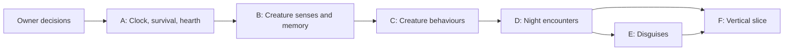

# Survival Gameplay and Creature AI: Roadmap (Milestone 04)

Status: **Phase A implemented** (2026-11-18): fixed-step simulation, game clock, needs, stove, `InteractableRef`. See [SIMULATION_AND_SURVIVAL.md](SIMULATION_AND_SURVIVAL.md) for what was built and how it differs from this plan. Phases B to F are still **proposed**.

**Baseline update:** the baseline problem in section 1 is resolved. `origin/main` (`4a8e570`) holds the full world, player, item and audio code, and this branch was fast-forwarded to it before Phase A. Section 1 is kept as written at planning time.
Owner approval needed for the items in [Open decisions](#open-decisions) before Phase A starts.

Companion documents:

- [CREATURE_AI_DESIGN.md](CREATURE_AI_DESIGN.md): perception, memory, behaviour, disguises.
- [SURVIVAL_SYSTEM_DESIGN.md](SURVIVAL_SYSTEM_DESIGN.md): clock, resources, fire, chimney.
- [AI_TESTING_STRATEGY.md](AI_TESTING_STRATEGY.md): how each phase is verified.

## 1. Baseline: what the source actually contains

The source is the authority. This section was checked against the **main checkout's working tree** (`D:\CODE ALL HERE PLEASE\Cold friend, come in`, branch `main`, HEAD `a22c408`). That tree holds about 50 modified or untracked files on top of HEAD: the world generator, `world/model`, `world/query`, `world/render`, `world/items`, `player/`, `interaction/`, `entity/`, `item/`, `inventory/`, `audio/` and the tests for them. **None of that is committed.** The planning worktree (`claude/milestone-04-planning-f9a5f8`, HEAD `a22c408`) contains only the menu, settings and backdrop code, so this planning branch cannot build the world. Before Phase A starts, commit or stash the main checkout's work so that the implementation branch has a single baseline.

Status legend used in every planning document:

- **Implemented**: present in source and read by a caller.
- **Partial**: present, but a stated part is missing.
- **Present, unused**: code exists but nothing in the game calls it.
- **Planned**: a package or document only, with no behaviour.
- **Absent**: not in source.

| Area | Status | Evidence (main checkout) |
|---|---|---|
| Seeded world generation | Implemented | `world/gen/WorldGenerator`, `TerrainStage`, `HydrologyStage`, `RegionStage`, `VegetationStage`, `StructureStage`, `WorldValidator`, `GenerationVersion`, `GoldenValues` test |
| Generated world data | Implemented | `world/model/WorldData` (immutable record: terrain, water, regions, placements, cabin, village, paths, locations), `HeightField`, `WaterMap`, `RegionMap` |
| Stable ids | Partial | `entity/EntityId` (long) is used for world items only (`WorldItems.nextId`). `PlayerId` is `record PlayerId(long)`, with `PlayerId.LOCAL` the only instance. Nothing else has an id. |
| Player movement | Implemented | `player/PlayerMovement` (no engine types), `PlayerInput`, `PlayerState`. Uses the **frame** `dt` (see risk R-2). |
| Collision | Implemented | `world/query/WorldCollision`: 8 m grid of circles for scenery, solid footprints for buildings, the cabin door, and `addObstacle`/`removeObstacle` for placed items. `lineClear` is used by placement validation only. |
| Terrain rules | Implemented | `world/query/TerrainRules.walkable` (slope 0.7, wade depth 0.8 m) |
| Navigation | Partial | `world/query/GridNavigation` computes a reachable set by flood fill (used by validation). There is **no runtime path finder**. `world/gen/PathFinder` is A* for path generation and is package-private. |
| World simulation | Implemented, with limits | `world/WorldSimulation` (294 lines): players, inventories, world items, cabin door, interaction requests, placement. Its `update(dt, inputs)` only moves players. |
| Interaction | Implemented (door and item pickup) | `interaction/Interactable`, `InteractableKind {DOOR, ITEM}`, `InteractionRequest(PlayerId, String id)`, `ActionResult`. `WorldSimulation.interact` checks the request against what the player can currently use, which is the right shape for a server later. |
| Items | Implemented | `item/*` (definitions, ids, stacks), `config/items.properties` (7 items), `world/items/*` (`ItemActions`, `PlacementValidator` with an ordered rule list, `WorldItems`, `StartingItems`). Only `stone` has a model. |
| Inventory | Implemented | `inventory/Inventory` (slots, merge, swap), `ui/InventoryView`, `state/InventoryState` |
| Cabin | Implemented (no function) | `world/model/CabinLayout` (walls, windows, door, bed, stove, table), `world/render/CabinView`. The stove is a box. **No fire, fuel or heat exists.** |
| Village | Implemented (shells) | `world/model/Village`, `VillageBuilding`, `world/render/VillageView`. Buildings are empty. |
| Time of day | Present, unused by the simulation | `state/LightingProfile` (DAY, DUSK, NIGHT) changes only the lighting and is selected by `dev.time`. There is **no clock** in the simulation. |
| Audio | Partial | `audio/Footsteps` (snow WAV, not positional), `audio/Ambience` (generated wind loop), `audio/WindLoop`, `audio/StepCounter` (pure, has a test). Fire, creature and music cues are absent. `StepCounter` sits in the `audio` package although the simulation would need it. |
| Development hooks | Implemented | `dev.spawn`, `dev.time`, `dev.scenario`, `dev.autostart`, `dev.screenshot` in `config/game.properties`; scripts run in `WorldPlayState.runScenario` |
| Survival (warmth, food, water, fire, firewood use) | Absent | `survival/package-info.java` only. The firewood item says it "burns slowly" and nothing burns it. |
| Creature | Absent | `creature/package-info.java` only. |
| Narrative | Absent | `narrative/package-info.java` only. |
| Save and load | Absent | Worlds regenerate from the seed. |
| Tests | 20 test classes | Listed under `src/test`. **I did not run Gradle for this plan**, so no pass or fail status is claimed. |

Documentation that is out of date:

- `docs/ARCHITECTURE.md` (committed) lists `world`, `player`, `interaction` and `audio` as planned or partial. The main checkout has them working. Update it in the handbook pass (see `MILESTONE_04_DOC_UPDATES.md`).
- `docs/GAME_DESIGN.md` lists "Not implemented: NPCs, items, survival needs, audio". Items and footsteps exist now.

## 2. Gaps that block the milestone

These are the architectural gaps that must be closed before creature or survival work. Each one is a Phase A task unless noted.

| ID | Gap | Why it blocks | Resolution |
|---|---|---|---|
| R-1 | The simulation has no clock. `dev.time` only changes the lights. | Night pressure, fire burn-down and creature schedules need game time. | `survival/WorldClock`: game minutes advanced by the simulation (Phase A). |
| R-2 | `WorldSimulation.update(dt)` uses the frame `dt`. | Creature decisions and survival rates would change with frame rate. Multiplayer needs a fixed tick. | A fixed 20 Hz step with an accumulator, inside `WorldSimulation.update` (Phase A). Player movement moves to the fixed step with a regression test. |
| R-3 | `StepCounter` lives in `audio`, and it is the source of "the player made a sound". | The simulation must not depend on audio. | Move the stride logic into `player/` (pure). Keep the audio call site. Phase A. |
| R-4 | Interactable ids are strings. The item branch parses `"item:" + long` back into an id. | Fragile; the creature will need to act on world objects too. | Replace the string with a small `InteractableRef` (door, or item `EntityId`). Phase A. This changes a record and its tests, not behaviour. |
| R-5 | `WorldData` is immutable. Felling a tree (for firewood) cannot change placements. | Chopping needs a "felled" overlay, and collision must honour it. | Simulation overlay `Set<Integer>` of removed placement indices. `WorldCollision` needs a `removeStatic` method, built from the same grid. Phase A, needed for the firewood loop. |
| R-6 | No runtime path finder. | The creature must route around cover and the cabin. | A grid A* in `world/query` that reuses `GridNavigation`'s walkable grid. Promote or copy the logic from `world/gen/PathFinder`; decide in Phase B. |
| R-7 | `WorldPlayState` is 549 lines and mixes input, HUD, placement and scenarios. | More survival UI would grow it further. | Do not add simulation rules there. New HUD goes in a small `ui` view fed by simulation read-models. |
| R-8 | `WorldSimulation` is 294 lines and will grow. | Risk of the "giant manager" the brief forbids. | Each subsystem is its own class (`WorldClock`, `Hearth`, `Survival`, `CreatureSimulation`). `WorldSimulation` only calls them in order. |

## 3. Recommended phase order

The brief's order is kept, with one addition: a small **Phase 0** of decisions and two safe refactors (R-2, R-4), folded into Phase A.

- **A before B**: the creature's schedule and the fire's protection both read the clock and the hearth.
- **B before C**: behaviours are scored from memory and perception; they cannot be written first.
- **E after D**: disguises change appearance and a few senses, but night threats must work with one form first.
- **F last**: integration only, no new mechanics.

Phases A and B could run in parallel after the clock lands, because they touch different packages. Keep one writer per package.

## 4. Phase breakdown

Each phase lists the twelve items the brief asks for. Items marked *(proposed)* are design choices in the companion documents, not facts about the code.

### Phase A: Gameplay foundation

1. **Objective:** a fixed-step simulation with a game clock, a survival state, a fire that burns fuel, and resource interactions that matter.
2. **Player-facing outcome:** the lighting follows the clock (`dev.time` becomes a start time, not a mode). Eating, drinking and feeding the fire are real actions, and cold and hunger show as a simple cue, not a bar-only system.
3. **Systems:** `WorldClock`, `Survival` (warmth, nourishment, hydration, health), `Hearth` (fire level, fuel, state), `ItemActions` (eat, drink, fill, feed), `WorldSimulation` (fixed step, felled trees), `InteractableRef`.
4. **Existing classes to reuse:** `WorldSimulation`, `PlayerMovement`, `Inventory`, `ItemActions`, `ItemCatalog`, `CabinLayout` (stove position), `WorldLocation` with `LocationKind.WATER_ACCESS`, `LightingProfile`, `WorldPlayState` (HUD and lighting only), `StepCounter` (moved), `WorldCollision`.
5. **New classes or packages:** `survival/WorldClock`, `survival/Survival`, `survival/SurvivalParameters` (record, `DEFAULT`), `survival/Hearth`, `survival/Fuel`, `world/query/` removal support, `interaction/InteractableRef`, `player/StepCount` (moved). Packages `survival` gets real code; `creature` stays empty.
6. **Dependencies:** none. This is the first phase. Owner decisions 1 and 2 (day length, fire rules) must be made first.
7. **Implementation tasks:**
   1. Add `WorldClock`: game minutes, `phase()` (DAY, DUSK, NIGHT, DAWN), a start time from `dev.time` (day 1 at 07:00, dusk 17:30, night 22:00).
   2. Add the fixed step to `WorldSimulation.update`: accumulator, 20 Hz, a cap on steps per frame (for example 5) to avoid spiral of death. Movement uses the fixed step. Keep `update(dt, inputs)` as the signature.
   3. Move `StepCounter` to `player/`; `Footsteps` keeps calling it. Add a sim-side "footstep" sense event (consumed by Phase B).
   4. Add `InteractableRef` and change `InteractionRequest` to carry it. Update `WorldPlayState` prompts and `WorldSimulation.interact`.
   5. Add `Hearth`: states UNLIT, BURNING, EMBERS, OUT; a `level` in [0, 1]; `fuel` in fuel-hours. Feeding a firewood item adds fuel; burn rate depends on level (see the survival design).
   6. Add `Survival`: warmth, nourishment, hydration and health, each in [0, 100]. Rates depend on phase, cabin or outside, and the hearth state.
   7. Add item actions: `ration` (eat), `water_container` to a full container at `WATER_ACCESS` (new item id `water_full`, config only), `firewood` into the stove, `branch` to clear the chimney (used by Phase D).
   8. Add `Hearth` and `Survival` read-models to the HUD: a small status line of four values and a fire state word.
   9. Add felling support (R-5): an axe-free version first. Chopping is a `dev` scenario action until the tool exists; a tree removed from the overlay stops blocking collision.
   10. Lighting: `WorldPlayState` picks `LightingProfile` from `WorldClock.phase()` each frame. `dev.time` sets the start.
8. **Automated tests:** `WorldClockTest` (phase boundaries, wrap at midnight, day count); `FixedStepTest` (same result for 60 fps and 144 fps over 10 s of input); `HearthTest` (burn rate per level, transitions, fuel never negative); `SurvivalTest` (rates by phase and location, clamp to [0, 100], health falls only when a stat is critically low); `ItemActionsSurvivalTest` (feeding, drinking, fill refusals); `StepCountTest` (moved test, same expectations); `FelledTreeCollisionTest`.
9. **Manual runtime verification:** start with `dev.time=night`; the lights are dark and the HUD shows a falling warmth. Feed the stove and watch the state change to BURNING. Fill the container at the water access point. Chop a tree (dev scenario) and walk where it stood.
10. **Acceptance criteria:**
    - The simulation is identical at 30, 60 and 144 fps for the same inputs (test).
    - One in-game day passes in the configured real time within 1%.
    - The stove and the four survival values behave as the survival design says, in unit tests.
    - No survival rule lives in `state/` or `ui/`.
11. **Risks:** the frame-rate change alters how movement feels; the fixed step must keep the same walking speed. Felling trees may open paths that the validator's reachability check assumed closed (re-run `WorldValidator`).
12. **Out of scope:** creature, sound events beyond footsteps, weather, saving, sleep, illness, weight, stamina.

### Phase B: Creature foundation

1. **Objective:** a creature entity that perceives through vision, hearing and traces, keeps memory with decay, and can move on the grid. Behaviour is one wander mode only.
2. **Player-facing outcome:** none, except a debug overlay (`dev.creature=true`) and a log line when the creature notices something. The creature exists in the world, but does not yet do anything the player can see.
3. **Systems:** `CreatureSimulation`, perception, memory, `CreatureNavigator`, sense events, the debug overlay.
4. **Existing classes to reuse:** `EntityId` (the creature's id), `PlayerId` (per-player beliefs), `PlayerState` (camera yaw and pitch are the only player data the perception reads), `WorldCollision.lineClear` and `move`, `HeightField.heightAt`, `GridNavigation` (walkable grid), `world/gen/PathFinder` (A* reference), `RandomStreams` (seeded randomness for creature choices).
5. **New classes or packages:** under `creature/`: `CreatureState`, `CreatureForm` (enum with parameters, Phase B uses WOLF only), `SenseEvent`, `Perception`, `Memory`, `Observation`, `CreatureNavigator`, `CreatureParameters` (record, `DEFAULT`). Under `world/query/`: `GridPathFinder`. Under `world/render/`: `CreatureView` (later, plus a debug view).
6. **Dependencies:** Phase A (clock, fixed step, sense events from footsteps and doors).
7. **Implementation tasks:**
   1. Add `CreatureState` with `EntityId`, form, position, heading, speed and mode. Created by `CreatureSimulation` in a seeded spot far from the cabin (at least 150 m, outside the village).
   2. Add `SenseEvent` (kind, x, z, loudness, time). `WorldSimulation` appends events each tick for footsteps, doors, drops and placements, and clears the list at the end of the tick.
   3. Add `Perception.sense(player, creature, context, time)`: vision (cone, range by phase, line of sight, terrain occlusion) and hearing (events within loudness, attenuated by walls). Returns observations, does not store them.
   4. Add `Memory` with bounded observations (at most 32), merge radius 8 m, linear decay per kind (see the creature design), and `lastKnown(PlayerId)` returning a position and confidence.
   5. Add `GridPathFinder`: A* over the walkable grid, 4 m cells, a cost for cover-free cells, and an iteration cap. Reuse `GridNavigation`'s walkable array.
   6. Add `CreatureNavigator`: holds a path, replans every 2 s or when blocked, steers with `WorldCollision.move`.
   7. Add the wander mode (ROAM) with seeded waypoints.
   8. Add the debug overlay: current mode, last known player position, confidence, cone and line of sight.
   9. Add the **information barrier** (see the testing strategy): the brain can only see `Memory`, `Perception` output and world data.
8. **Automated tests:** `PerceptionVisionTest` (cone edges, range by phase, occlusion by trees and buildings, terrain ridge occlusion); `PerceptionHearingTest` (loudness, walls); `MemoryDecayTest`; `MemoryMergeTest`; `GridPathFinderTest` (path cells walkable, no path through solids, cap respected); `InformationBarrierTest`.
9. **Manual runtime verification:** with the overlay on, walk behind a tree and watch the creature's sighting go stale. Close the door and watch the hearing event stop refreshing.
10. **Acceptance criteria:**
    - A creature never has the player's position unless perception produced it this tick (barrier test passes).
    - Vision and hearing results match the hand-computed fixtures.
    - One AI tick (perception plus decision) for one creature averages under 0.5 ms on the dev machine, with no per-tick allocation beyond the bounded observation list (measured).
11. **Risks:** terrain occlusion sampling cost; the seed may place a creature inside a building; grid A* on a 1536 m world must be bounded (use the 4 m grid, cap nodes at about 4000).
12. **Out of scope:** any behaviour except wander; creature visuals; attacks; disguises; sound from creature.

### Phase C: Creature behaviours

1. **Objective:** the creature behaves as a predator that studies the player: observes, stalks at distance, investigates sounds and tracks, circles the cabin, and withdraws when seen.
2. **Player-facing outcome:** the creature is seen only at the edge of view or in a window or at a track. It keeps out of the camera's cone. It sometimes leaves without acting.
3. **Systems:** the mode layer (utility-selected finite state machine), behaviours (`Observe`, `Stalk`, `Investigate`, `Circle`, `Hold`, `Withdraw`), the restraint rule, creature visibility to the player (the view).
4. **Existing classes to reuse:** Phase B's perception, memory and navigator; `WorldCollision`; `Cabin` and `CabinLayout` (perimeter ring and windows); `Hearth` (the light and the protection radius).
5. **New classes or packages:** `creature/CreatureMode` (enum), `creature/CreatureBrain` (scores candidate modes), `creature/Considerations` (values computed from memory and world), `creature/behaviour/*` (one small class per behaviour that implements a `Behaviour` interface with `enter`, `update`, `exit`), `creature/Restraint`.
6. **Dependencies:** Phase B. Phase A's hearth and clock for the light and night rules.
7. **Implementation tasks:**
   1. Add `CreatureMode`: ROAM, INVESTIGATE, OBSERVE, STALK, CIRCLE, PROBE, HOLD, STRIKE, WITHDRAW.
   2. Add `CreatureBrain`: every 1 s of sim time (every fifth AI tick), compute a score for each mode from considerations. Keep the current mode unless another scores 15% higher or the current mode's minimum commit time (4 s, or 20 s for STRIKE) has passed.
   3. Implement OBSERVE and HOLD: choose a cover spot with line of sight to the cabin or the trail and no line of sight from the player's view cone.
   4. Implement STALK: keep 25–40 m away, move only through cells outside the cone.
   5. Implement INVESTIGATE: go to the most recent sound or track position with confidence above 0.2, then search a few points around it.
   6. Implement CIRCLE: a ring 12–18 m around the cabin, cover cells only.
   7. Implement WITHDRAW: move away from the player along cover, out of view, with a restraint cooldown.
   8. Implement restraint: after a near-contact, the creature's strike chance drops for 3–6 game minutes and it may choose HOLD even when strike scores high (seeded).
   9. Add `CreatureView`: draws the creature only when the creature's cell is seen (the view takes the same line-of-sight check as perception, for the player). Visibility is presentation, decided by the simulation's visible flag.
8. **Automated tests:** `CreatureBrainTest` (score ordering for fixed considerations; hysteresis; minimum commit time); one scenario test per behaviour (scripted player, asserted mode transitions); `RestraintTest` (strike rate over 1000 seeded trials below the configured bound); `CoverSelectionTest` (chosen cover never in the player's cone).
9. **Manual runtime verification:** at night, with the overlay, walk toward the creature's cover. It should withdraw before you can see it clearly. Stand still in the open for a minute; it should circle and not approach while you face it.
10. **Acceptance criteria:**
    - Over 50 seeds and a 30-minute night, the creature's mode sequence is recorded; every run includes at least two different modes and at least one non-strike night.
    - The creature enters the player's view cone within 20 m in less than 10% of ticks when the player moves normally (measured by the scenario harness).
    - No behaviour moves the creature through a solid (property test).
11. **Risks:** the brain can oscillate between modes; the creature can stall when it has no cover. Tune with the overlay, not with screenshots.
12. **Out of scope:** attacks that damage the player (STRIKE ends in a stub until Phase D), disguises, speech, multiple creatures.

### Phase D: Survival encounters

1. **Objective:** nights become dangerous and fair. The creature tests the cabin, is repelled by a well-kept fire, can block the chimney with snow, and the player must notice and respond.
2. **Player-facing outcome:** a knock or a scrape at the door at night, a dimmer fire, smoke that thins. The player can answer: feed the fire, clear the chimney, stay inside, or go out.
3. **Systems:** fire protection (a radius where the creature's cost rises), the chimney interference event, the STRIKE result (damage through the door or window when the fire is weak), the cue log that proves fairness.
4. **Existing classes to reuse:** `Hearth`, `Survival`, `CreatureBrain`, `WorldCollision` (door and window openings), `CabinLayout` (windows), `ItemActions` (branch to clear the flue).
5. **New classes or packages:** `survival/Chimney` (blocked or clear), `survival/CueLog` (records what the player could have sensed, with time), `creature/Threat` (computes danger for the brain from hearth and cabin state), `creature/Strike` (the attack resolution).
6. **Dependencies:** Phases A, B and C.
7. **Implementation tasks:**
   1. Fire protection: when `Hearth` is BURNING at level ≥ 0.3, creature movement cost rises within 25 m of the cabin and STRIKE is not selected inside that radius.
   2. Chimney: the creature can choose a PROBE action at the roof (seeded) that sets `Chimney.blocked` for 3 game minutes. A blocked chimney lowers hearth level by 0.1 per game minute and thins the smoke. A "scrape" sense event is produced.
   3. Player response: a chimney interactable inside the cabin near the stove (`branch` item). Clearing removes the block.
   4. Door probe: PROBE at the doorstep produces a loud knock event. The player may open the door (opens the cabin to the creature's perception and to the strike rule).
   5. STRIKE resolution: if the creature reaches the doorstep with the door open or a window open and the hearth is weak, Health falls by a set amount per second while the player is within 3 m of the opening. The player's only response is to step away or close the door.
   6. Cue log: every damage event must have at least two cues in the 30 s before it (knock, scrape, smoke drop, fire low, footprint at the door). Log them; the test checks.
   7. Night lighting: the cabin windows glow when the hearth is burning. The windows are a signal to the creature (Considerations).
8. **Automated tests:** `FireProtectionTest` (cost and strike exclusion within radius); `ChimneyTest` (block, decay, clear); `CueLogFairnessTest` (every damage event over 200 seeded nights has ≥2 cues in the prior 30 s); `StrikeResolutionTest`.
9. **Manual runtime verification:** let the fire go out on a night, then watch the creature approach the door. Feed the stove and see it keep distance. Block the chimney (scenario) and clear it.
10. **Acceptance criteria:**
    - The fairness test passes for 200 seeds.
    - A well-kept fire (level ≥ 0.3) prevents STRIKE within 25 m in all seeded runs.
    - A player who does nothing can die at night, but never without at least two cues.
11. **Risks:** the fairness rule can make the creature harmless if cues are too strong; tune with the cue log counts. Chimney and door logic must not conflict with placement or collision.
12. **Out of scope:** damage models beyond health, injuries, bears, wolves, humans.

### Phase E: Advanced creature behaviour (disguises and deception)

1. **Objective:** the creature takes animal and human forms, using the same brain and memory with different appearance and capabilities.
2. **Player-facing outcome:** a wolf that stands still on a ridge; a bear that goes to a food smell (rations or garbage left out); a human voice at the door at night that asks to come in.
3. **Systems:** `CreatureForm` parameters (speed, hearing, cover use, abilities), appearance selection, the "knock and ask" dialogue for the human form (a small set of lines, chosen by state, no free-form generation).
4. **Existing classes to reuse:** everything from Phases B to D; `PropKind` and `PropCatalog` (models chosen by kind, never by filename); `ItemCatalog` (ration as bait).
5. **New classes or packages:** `creature/CreatureForm` gains WOLF, BEAR, HUMAN parameters; `creature/Disguise` (appearance, not identity); `creature/Lines` (dialogue lines with conditions); `survival/Garbage` (food left outside as a sense source).
6. **Dependencies:** Phase D. Owner decisions on characters (GAME_DESIGN "Characters" is a placeholder).
7. **Implementation tasks:**
   1. Wolf: stalk speed, a "feigned death" HOLD variant (no movement, sound off), attack only when the player is within 4 m and not facing it.
   2. Bear: an extra consideration for food scent (sense event from discarded food). Stays out of the cabin's cone; leaves when the player approaches with a lit fire.
   3. Human: may walk on paths (movement cost table per form), knocks (PROBE with a voice event), and selects one of a few lines based on the player's last action and the hearth state. The lines are data in config, not code.
   4. Identity and appearance stay separate: the brain keeps one `CreatureState`; `Disguise` only changes which form's parameters and model the view shows.
8. **Automated tests:** `FormParametersTest` (each form's parameters loaded and bounded); `DisguiseIdentityTest` (switching form keeps memory and mode); `HumanKnockTest`; `LinesSelectionTest` (deterministic for fixed state).
9. **Manual runtime verification:** a night with the human form: the knock, the question, a player decision, the response. A day with the bear near rations.
10. **Acceptance criteria:**
    - Switching form changes parameters and appearance but not `CreatureState.id` or `Memory`.
    - No form is a subclass. A new form is one enum entry plus data.
11. **Risks:** the human conversation can grow large; keep it to a branch table of at most a few dozen lines. Owner must approve tone and content.
12. **Out of scope:** free-text or generated dialogue, voice audio, real deception mechanics that lie about the world state.

### Phase F: Playable vertical slice

1. **Objective:** a complete loop: a day of preparing, a night of pressure, and a death and restart flow, with basic audio and visual feedback.
2. **Player-facing outcome:** the player can start a new game in the cabin at 07:00, prepare, go out, return before dusk, survive a night, see the morning, or die and restart from a new seed.
3. **Systems:** the day loop (clock, survival, hearth), the night loop (Phase D), a death screen and restart (`state/` only), a minimal audio layer (fire crackle, creature cues, night wind), a day counter.
4. **Existing classes to reuse:** `ScreenNavigator`, `MainMenuState`, `PauseState`, `WorldPlayState`, `Ambience`, `Footsteps`, `WindLoop`, `LightingProfile`.
5. **New classes or packages:** `state/DeathState`, `audio/FireSound`, `audio/CreatureCue` (placeholder sounds acceptable), `survival/DayCounter`.
6. **Dependencies:** Phases A to E (E is optional; the slice can ship with WOLF only).
7. **Implementation tasks:**
   1. Day counter and the seven-day structure (owner decision 3).
   2. Death: health 0 shows `DeathState`, then restarts from a new seed or continues from the morning (owner decision 4).
   3. Fire crackle loop, creature cue sounds, and night wind level linked to `WorldClock`.
   4. Visual cues: the creature's silhouette at the edge of a window at night, smoke from the chimney, snow on the stove.
   5. Playtest notes recorded in `docs/development/PLAYTEST_LOG.md` (new file, created in Phase F).
8. **Automated tests:** a full scripted run from 07:00 to the next 07:00 with a fixed seed and a fixed input script, asserting: the day counter increments, survival values remain in range, the creature enters at least one non-ROAM mode, and the run ends with either survival or a death followed by restart.
9. **Manual runtime verification:** three complete in-game days by hand, using the dev screenshot for each phase. Two deaths, one by cold and one by the creature, each with cues in the log.
10. **Acceptance criteria:**
    - A seeded full run completes without exceptions and without any value out of range.
    - Every death has its cue log attached.
    - Owner playtest signs off the fear and the fairness, recorded in the playtest log.
11. **Risks:** audio asset availability; the creature can feel too easy or too hard, which only playtesting finds. Keep the tuning in `*Parameters.DEFAULT`.
12. **Out of scope:** narrative, the shaman, the village events, saving, multiplayer, release polish, optimisation beyond the budgets in the testing strategy.

## 5. Critical architectural decisions

These become decision log entries (see `MILESTONE_04_DOC_UPDATES.md`). All are **Proposed**.

1. **Simulation owns the clock and a fixed step.** Rendering only reads it.
2. **Creature, survival and clock are separate classes that `WorldSimulation` calls in order.** No event bus; a per-tick list of `SenseEvent`s is the only shared channel.
3. **Creature decisions use memory only.** The creature cannot read `PlayerState` directly. Enforced by a test.
4. **Mode selection is a small finite state machine whose transitions are chosen by scored considerations** (see the creature design for why not a behaviour tree or GOAP).
5. **Tuning values live in `*Parameters.DEFAULT` records**, not in `config/game.properties`, because the creature and survival values are part of the game's balance, the same reason D-012 keeps generation parameters out of the config file. The `dev.*` keys remain in the config.
6. **Appearance is data (`CreatureForm`), identity is `CreatureState`.** No inheritance per disguise.
7. **Stable ids:** `EntityId` for creature, objects and felled trees; `PlayerId` for beliefs about players.

## 6. Main technical risks

| ID | Risk | Likelihood | Mitigation |
|---|---|---|---|
| T-1 | Work starts on the wrong baseline (committed HEAD lacks the world code). | High, now | Commit or stash the main checkout's work first (see section 1). |
| T-2 | Frame-rate-dependent simulation makes AI tuning meaningless. | High | Fixed step in Phase A, with a test. |
| T-3 | Terrain line-of-sight cost. | Medium | Sample at 2 m, cap samples, cache per tick. Measure. |
| T-4 | Creature unfair (no cues) or harmless (too many cues). | High | Cue log and fairness test; playtest sign-off. |
| T-5 | Felled trees invalidate reachability validation. | Medium | Re-run `WorldValidator` on felling; test. |
| T-6 | Brain oscillates between modes. | Medium | Hysteresis and minimum commit times; scenario tests. |
| T-7 | `WorldSimulation` and `WorldPlayState` grow into giant classes. | High | R-7 and R-8. |
| T-8 | Audio assets missing or late. | Medium | Phase F only; placeholders are acceptable. |
| T-9 | Owner has not decided day length, fire rules or creature rules. | High | Use the defaults in the survival and creature designs, mark them as proposed, and tune in playtest. |

## 7. Recommended first implementation phase

**Phase A, starting with Phase 0 (decisions) and the two safe refactors R-2 (fixed step) and R-4 (`InteractableRef`).** Those two are small, testable and unblock everything. Do not start creature code before the fixed step exists.

## 8. Acceptance criteria for handing this plan to Claude Opus

Hand the plan over when all of the following are true:

1. The main checkout's uncommitted world, player and item code is committed or otherwise placed on the implementation branch, and `gradlew test` passes there. (Not run for this plan; the implementer must run it.)
2. Owner decisions 1 to 4 below are answered, or the defaults are explicitly accepted.
3. The implementer reads the three companion documents before writing code.
4. Phase A's acceptance criteria are the first task list. No Phase B work starts until Phase A's tests pass.
5. Every new class has a unit test, or a scenario test if it is a simulation rule. Every new value sits in a `*Parameters.DEFAULT` record.
6. Each phase ends with a short entry in the decision log for any choice that differs from this plan.

## Open decisions

These need the owner. Defaults are proposed so that work is not blocked.

1. **Day length and the day's phases.** Proposed: 1 in-game day = 20 real minutes; day 07:00–17:00, dusk 17:00–19:30, night 19:30–05:30, dawn 05:30–07:00.
2. **The fire.** Proposed: must be tended; it burns down and goes out when unfed; a level ≥ 0.3 keeps the creature out of the 25 m protection radius.
3. **Seven-day structure.** Proposed: day 1 begins at 07:00; the shaman's arrival is at dawn of day 8 and is not implemented in this milestone.
4. **Death flow.** Proposed: death shows a short screen and restarts the same seed at 07:00 of the day the player began it. Alternative: a new seed.
5. **Creature first appearance and rules.** Proposed: no sighting before the first night; the creature is never seen in daylight within 40 m.
6. **Config format.** Unchanged: keep `.properties` (D-004).
7. **Dev keys before release.** Unchanged: `dev.*` stays until release.
