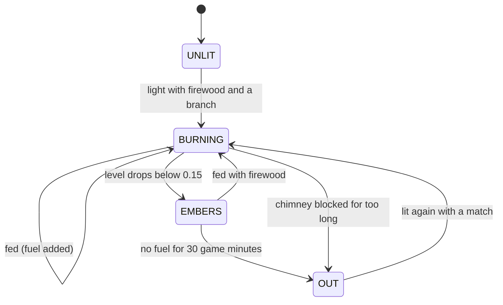

# Survival System Design

Status: **Partly implemented.** Sections 2 to 6 (clock, warmth, food and water, the hearth, health) were built in Milestone 04 Phase A; the actual behaviour and the differences from this design are in [SIMULATION_AND_SURVIVAL.md](SIMULATION_AND_SURVIVAL.md). Felling trees, the chimney and the cue log are still proposed. The text below is the design as written before Phase A. At that time the `survival` package was empty (`survival/package-info.java`). The only survival-related code today is the cabin's stove (a box in `world/model/CabinLayout`), the `firewood` item description ("they burn slowly"), and `LightingProfile` (lighting only). Nothing burns fuel, and nothing tracks the player's body.

See also: [SURVIVAL_GAMEPLAY_ROADMAP.md](SURVIVAL_GAMEPLAY_ROADMAP.md), [CREATURE_AI_DESIGN.md](CREATURE_AI_DESIGN.md).

## 1. Design principle

Every survival mechanic must create a **decision**, and no mechanic may be a chore that is always done the same way. The test for each mechanic: *does the player have a reason to choose differently on different days?*

The minimal set for the first playable version is:

| Keep (Phase A) | Why |
|---|---|
| Game clock with day, dusk, night | Night is when the creature acts. Everything else depends on it. |
| Warmth (body, tied to the cabin and the fire) | The fire is the sanctuary. Cold is the most visible threat. |
| Fire state and fuel (hearth) | The main decision: how much wood to use, and when to go out for more. |
| Nourishment (food) | One reason to leave the cabin in daylight. |
| Hydration (water) | Second reason to leave, and a reason to visit the river. |
| Health | Single value that falls when a survival value is critical. Gives death a path. |
| Firewood gathering by chopping | Makes the forest a place of work and noise. |

Postponed (not in the first playable version): stamina, sickness, wet clothing, injury from wading, weight, weather, sleep, hunger as separate states, crafting, a second tool, food spoilage, container capacity. Each can be added later as a rule on the same values if playtest shows a need.

## 2. The clock

`survival/WorldClock`:

- Holds **game minutes** since the start of day 1 (a `long` or `double`). Advanced by the fixed simulation step (20 Hz), never by frame time.
- Mapping: 1 in-game day = 1440 game minutes = 20 real minutes (proposed). So 1 game minute = 0.8333 s real.
- Phases (proposed):

| Phase | Clock time | Lighting | Creature |
|---|---|---|---|
| DAWN | 05:30–07:00 | DUSK profile | Sight range 35 m |
| DAY | 07:00–17:00 | DAY profile | Sight range 60 m, restrained |
| DUSK | 17:00–19:30 | DUSK profile | Sight range 35 m |
| NIGHT | 19:30–05:30 | NIGHT profile | Sight range 15 m, most active |

- `dev.time` sets the **start** time: `day` = 12:00, `dusk` = 18:00, `night` = 22:00 on day 1 (today's `dev.time` values, now meaning a time of day). Existing screenshots keep their look.
- The clock exposes read-only `phase()`, `dayNumber()` (starts at 1), `minutesOfDay()`.
- Day counter and the seven-day structure are owner decisions (roadmap open decision 3). The clock does not decide what happens on day 7.

## 3. Warmth

One value, `warmth` in [0, 100].

**Target** (what warmth moves toward), computed each game minute:

| Situation | Target |
|---|---|
| In cabin, hearth BURNING at level ≥ 0.3 | 85 |
| In cabin, hearth BURNING below 0.3 or EMBERS | 55 |
| In cabin, hearth OUT | 25 |
| Outside, DAY | 40 |
| Outside, DUSK or DAWN | 25 |
| Outside, NIGHT | 12 |
| Outside, wading (depth > 0.25 m) | target minus 25 |

- Warmth moves toward its target at **4 points per game minute** when rising and **2 per game minute** when falling. A fire warms the cabin fast; cold takes time to bite, so the player feels the danger coming.
- Warmth below 20 is **critical**: it lowers health.
- Walking through snow does not change the target in this version. Wind is postponed.

Expected daily cost (proposed): a player who spends day outside in DAY and returns at dusk loses about 15 warmth, and a night in a burning fire loses nothing.

## 4. Nourishment and hydration

Two values, each in [0, 100].

| Value | Drain (per in-game day) | Restore | Source |
|---|---|---|---|
| `nourishment` | 70 | `ration`: +45 | `ration` item (eat) |
| `hydration` | 90 | `water_full` (a filled container): +30 per drink, 1 unit per drink | Filled at a `WATER_ACCESS` location, or drink from the river at a water tile (costs a unit of warmth as well, see below) |

Starting kit gives 2 rations and 1 water container, which is about one day's supply for both.

- Drink from the **container** requires a full container (`water_full`). Filling needs standing within reach of `WATER_ACCESS` (existing `WorldLocation`). Filling converts `water_container` to `water_full` (one stack to another; config only).
- Drink directly from the river: allowed, +30 hydration, −5 warmth (cold water). This is the risky option: no container needed, but the player must stand in the river, which the creature can hear (WATER sound, Phase D).
- Both drain linearly with game time. At 0, **health** falls (see section 6).

Why not one "food and water" value: separate values give two different reasons to go to the river, and each can be known by the player from the HUD.

## 5. The hearth (fire)

### 5.1 States

- The stove exists as a furnishing (`CabinLayout`, "stove", height 1.0 m). The hearth attaches to it. No new geometry.
- Lighting needs `matches` (existing item, one match is consumed per light) plus kindling (`branch`), then firewood.
- `UNLIT` is the start state for a new world unless the stove is given starting fuel and a light (decide with the owner; proposal: start lit, to teach the fire first).

### 5.2 Fuel and burn rate

- One **firewood** item adds **1 fuel-hour** to the hearth. Fuel is a number, stored in the hearth, not in the item stack.
- Level `L` in [0, 1] is set by the player through feeding: a feed adds fuel and sets the target level based on how much was fed in one go (maximum 0.9, the stove's cap).
- Burn rate: `fuel` drains by `L` fuel-hours per in-game hour. So:
  - Level 0.5 burns 12 firewood per day (too much, so the player never sets 0.5 for long).
  - Level 0.3 burns about 7 firewood per day.
  - A night (10 in-game hours) at level 0.3 burns about 3 firewood.

Target balance (proposed): a player who keeps the fire at about 0.3 through a night and a few hours of the evening spends **4–6 firewood per day**. The starting kit has **4 firewood + 3 by the stove** (7 total), so day 1 is comfortable, and day 2 onward needs gathering.

### 5.3 Gathering firewood

- **Chopping**: a tree (a `Placement` from `WorldData`) felled with an axe or a stick. There is no axe item. Proposal: add `axe` (category TOOL, not stackable, config only) and a chop action at a tree within 2.2 m (same reach as the door).
- A felled tree yields **2–3 firewood** (seeded per tree, so the same seed gives the same yields) and a CHOP sound event (loud, 30 m).
- Felling removes the tree from collision (overlay, see roadmap R-5). Felling does not change `WorldData`.
- Branches are found on the ground (`StartingItems` places two by the door). Branches are kindling; they do not fuel the fire.
- Each chop takes 4 game seconds of player time (a timed action, not instant). Interrupted if the player moves away.

Decision this creates: a tree near the cabin is cheap to reach, but the chop is loud and near the creature's usual route; a tree far away is quiet, but the trip is long and the cabin cools. Both are visible to the player from the map (the same terrain rules apply).

### 5.4 Maintenance and cues

- A fire at level below 0.3 shows the player a cue: the window glow fades, and the crackle sound (Phase F) softens.
- An EMBERS hearth shows smoke that is thin and grey. This is the same cue the creature can use (Phase D).
- Every state change of the hearth is written to the cue log (survival design, section 8) for the fairness test.

## 6. Health

- One value, `health` in [0, 100], starts at 100.
- Falls by **1 per game minute** while any of these is critical: warmth < 20, nourishment < 10, hydration < 10.
- Falls by **4 per game minute** while two or more are critical.
- Recovers by **1 per game minute** when none of the four values is below 40.
- A **wound** (from creature STRIKE, Phase D) reduces health by a fixed amount; `bandage` (existing item, in the starting kit) restores 25 health and stops the wound's drain.
- At 0 health the player dies. Death handling is in Phase F (roadmap open decision 4).

Why health is derived, not a separate hazard: each value is visible, and death is always preceded by a value the player could see falling. This supports the fairness rule.

## 7. Environment

Phase A and D include only what the survival rules need:

| Factor | Used for | Status |
|---|---|---|
| Time of day | Creature range, warmth target, lighting | Phase A |
| Wading | Warmth target | Phase A (uses `PlayerMovement.WADE_DEPTH`) |
| Cabin inside or outside | Warmth target | Phase A (uses `WorldCollision` door and cabin footprint; simplest test is the cabin footprint `contains`) |
| Snow covering tracks | Creature tracks lifetime | Phase B (lifetime constant only) |
| Wind | Hearing masking, warmth | **Postponed** |
| Weather and blizzards | Visibility, warmth | **Postponed** |

## 8. Cue log and fairness

The cue log is the link between survival and the creature, and the way fairness is enforced.

`survival/CueLog`:

- Ring buffer of the last 60 in-game minutes of **cues** the player could perceive: `CueKind` such as `FIRE_LOW`, `SMOKE_THIN`, `WARMTH_CRITICAL`, `HUNGER_CRITICAL`, `HYDRATION_CRITICAL`, `KNOCK`, `SCRAPE`, `FOOTPRINT_AT_DOOR`, `WINDOW_SILHOUETTE`, `CHOP_NEARBY`.
- Each cue has a time and a position (if any).
- Preallocated buffer; no per-tick allocation.

Rule: **every damage event (health loss from creature or survival) must have at least two cues in the 30 game minutes before it**, or the event is a bug. Survival-only deaths (cold, hunger) always have their own warning cues from section 6, so the rule holds for them too. The test is in the testing strategy.

## 9. Interactions introduced by this design

| Action | Requires | Effect | Sense event (creature) |
|---|---|---|---|
| Eat ration | in inventory | nourishment +45 | none |
| Drink from container | `water_full` | hydration +30 | none |
| Fill container | `water_container`, at `WATER_ACCESS` | item change | DROP-sized splash, 3 m (proposed) |
| Drink from river | at water tile | hydration +30, warmth −5 | SPLASH, 6 m (proposed) |
| Feed stove | firewood, at stove | fuel +1 each, level set | none (quiet) |
| Light stove | matches, branch | UNLIT → BURNING | 4 m |
| Chop tree | axe (or stick, Phase D), at tree | tree felled, +2–3 firewood | CHOP, 30 m |
| Clear chimney | branch, inside, near stove | chimney clear | none |
| Bandage | bandage | health +25, wound drain stops | none |

Each action goes through `WorldSimulation` as an `InteractionRequest` (see roadmap R-4), so a future server could validate it.

## 10. Where the rules live

| Rule | Class | Package | Pure |
|---|---|---|---|
| Clock and phases | `WorldClock` | `survival` | yes |
| Fuel, level, state | `Hearth` | `survival` | yes |
| Warmth, nourishment, hydration, health | `Survival` | `survival` | yes |
| Parameters | `SurvivalParameters` (record, `DEFAULT`) | `survival` | yes |
| Cue log | `CueLog` | `survival` | yes |
| Felled trees | overlay `Set<Integer>` in `WorldSimulation`; `WorldCollision.removeStatic` | `world`, `world.query` | yes |
| Item actions | extend `ItemActions` | `world.items` | yes |
| HUD | small view in `ui/` or `state/` fed by read-models | presentation | no |

No survival rule lives in `state/`, `ui/` or `world/render`. The HUD asks for values and draws them.

## 11. Parameters (proposed, in `SurvivalParameters.DEFAULT`)

| Name | Value |
|---|---|
| `GAME_MINUTES_PER_REAL_SECOND` | 1.2 (1 day = 20 real minutes) |
| `WARMTH_RISE_PER_MIN` | 4 |
| `WARMTH_FALL_PER_MIN` | 2 |
| `WARMTH_CRITICAL` | 20 |
| `NOURISHMENT_DRAIN_PER_DAY` | 70 |
| `HYDRATION_DRAIN_PER_DAY` | 90 |
| `RATION_RESTORE` | 45 |
| `WATER_RESTORE` | 30 |
| `RIVER_DRINK_WARMTH_COST` | 5 |
| `FUEL_PER_FIREWOOD` | 1.0 fuel-hour |
| `FIRE_LEVEL_MAX` | 0.9 |
| `FIRE_PROTECTION_LEVEL` | 0.3 |
| `EMBERS_THRESHOLD` | 0.15 |
| `EMBERS_TO_OUT_MIN` | 30 |
| `TREE_FIREWOOD_MIN` / `MAX` | 2 / 3 |
| `CHOP_SECONDS` | 4 |
| `HEALTH_DRAIN_ONE_CRITICAL` | 1 per game minute |
| `HEALTH_DRAIN_TWO_CRITICAL` | 4 per game minute |
| `HEALTH_RECOVER` | 1 per game minute |
| `BANDAGE_HEAL` | 25 |
| `CUE_WINDOW_MIN` | 30 game minutes |

## 12. Open points for the owner

These are also in the roadmap's open decisions.

1. Start the game with the stove lit, or unlit?
2. Is a river drink (risky, no container) acceptable as a design choice?
3. Is the firewood balance above (4–6 per day) the right level of chore?
4. Is the creature's sound on chopping (30 m) acceptable, or should chopping be quieter so the player is not punished twice?
